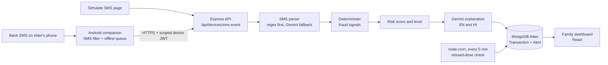

<div align="center">

# SurakshaDigi

**An elder-safety platform that catches payment fraud from real bank SMS and watches medication adherence, so families don't have to hover.**

[](https://suraksha-digi-dashboard.vercel.app)
[](https://suraksha-digi-backend.onrender.com)


[Try it in 30 seconds](#try-it-in-30-seconds) · [How it works](#how-it-works) · [Fraud engine](#the-fraud-engine) · [Engineering highlights](#engineering-highlights) · [Run locally](#run-it-locally)

</div>

---

## The problem

Elderly people are the most targeted group for UPI and OTP scams, and the people who care about them cannot watch every text message. Existing options either need the elder to do something technical, or they hand the decision to an AI model that nobody can audit.

## What SurakshaDigi does

A family member signs in to a dashboard, adds an elder, and optionally pairs the elder's Android phone. From then on:

- **Fraud monitoring.** Incoming bank and UPI SMS are detected on the phone, parsed, scored against deterministic fraud signals, and raised as alerts on the family dashboard, with a plain-language explanation in English and Hindi.
- **Medication monitoring.** Doses are scheduled per elder, and a server-side job detects missed doses and raises severity-based alerts even when nobody has the dashboard open.
- **One decision-maker.** The risk score is computed by the application. Gemini only explains a decision that has already been made. It never decides, and it is instructed not to invent evidence.

> Validated end-to-end on a real phone: two live ₹1 UPI transactions were sent, detected, uploaded, scored and shown on the live dashboard, with no manual steps.

---

## Try it in 30 seconds

You do not need Android Studio or a phone.

1. Open the **[live dashboard](https://suraksha-digi-dashboard.vercel.app)** and sign in as a Family user (the first request can take about a minute while the free Render instance wakes up).
2. Open **Simulate SMS**, pick an elder, and paste a bank-style message, for example one containing `share OTP` and a new recipient.
3. Watch it run through the **same pipeline the Android app feeds**: parsing, signal scoring, risk level, explanation, alert.

---

## How it works



The dashboard and the Android app are two front doors into **one** fraud pipeline. There is no separate scoring path to drift out of sync.

---

## The fraud engine

Every transaction is scored from five signals. The weights are fixed and the total is capped at 100.

| Signal | Weight | What it checks |
|---|---:|---|
| New recipient | 25 | Has this elder paid this recipient before? |
| Unusual amount | 25 | Is the amount far from the elder's own history? |
| Unusual time | 15 | Is the transaction at an atypical hour (IST)? |
| High velocity | 20 | Several transactions inside a 10-minute window |
| Scam keyword | 25 | Phrases such as "share OTP", urgency, account-block threats |

```
0 – 29   → LOW
30 – 59  → MEDIUM
60 – 100 → HIGH
```

**Guardrails that keep it honest:**

- Behavioural signals (amount, time, velocity) need history before they can create a HIGH. Scam-keyword content is deliberately exempt, so a clear scam on a brand-new account is not stuck at MEDIUM.
- A HIGH made only of soft, circumstantial signals is capped at MEDIUM.
- Negation is scoped, so "do **not** share your OTP" is not flagged as a request to share it, and pivot words like "but" and "however" reset that scope.
- Gemini receives the finished evidence and writes the explanation. It cannot change the level.

---

## Engineering highlights

These are real bugs found while testing against a physical device and live data, and how they were fixed.

- **A broadcast receiver that silently received nothing.** `SmsReceiver` was declared `android:exported="false"`. `SMS_RECEIVED` comes from the Telephony framework under a different UID, so Android dropped it with no error and no log line. Setting `exported="true"` fixed real-SMS detection immediately.
- **A recovery path that never ran.** The duplicate-event check on the real Android route returned early and skipped missing-alert recovery that the shared pipeline already had. The fix extracted one shared function used by every caller. Deleting the early return outright would have caused a fresh Gemini call on every phone retry of a scam SMS, so it was kept for its real purpose.
- **A fix whose root cause was deeper than the report.** Adding pivot-word handling fixed "but" but not "however". The real cause was elsewhere in the negation scoping, found by reproducing the failing messages first.
- **Offline-first delivery.** SMS events are stored in a local SQLite queue with a SHA-256 event ID and retried through `JobScheduler`, so a network drop loses nothing and a retry never double-counts.
- **Idempotent background job.** Missed-dose detection is IST-aware, writes alerts with source linking, and is backed by a unique log per medication per date.

---

## Security and privacy

- Family and elder accounts use JWT auth with bcrypt-hashed passwords. Android uses a separate, device-scoped JWT.
- Pairing is one-time: a 12-character code, valid for 10 minutes, exchanged for a device token that is encrypted at rest with the Android Keystore.
- The Android app **does not read the SMS inbox**. It reacts only to new messages that look like bank transactions, and everything else is ignored and never transmitted.
- Role and ownership checks on protected routes, so a family can only reach its own elders.
- Helmet headers, rate limiting on login, registration, forgot-password and device pairing, input validation, secrets in environment variables, HTTPS-only traffic from the app.
- Forgot-password responses never reveal whether an account exists.

---

## Repository layout

This is a monorepo. Each folder deploys independently.

```
suraksha-digi/
├── backend/     Node.js + Express API, fraud engine, background jobs     → deployed on Render
├── frontend/    React 19 + Vite family dashboard                         → deployed on Vercel
└── android/     Native Java companion app (SMS capture, offline queue)   → built locally as an APK
```

| Folder | Details |
|---|---|
| [`backend/`](./backend) | API routes, models, services, tests. See its [README](./backend/README.md). |
| [`frontend/`](./frontend) | Pages, auth context, Axios client. See its [README](./frontend/README.md). |
| [`android/`](./android) | Receiver, queue, upload job, Keystore storage. See its [README](./android/README.md). |

**Deployment mapping:** Render uses `backend` as its Root Directory and Vercel uses `frontend`, so a commit that only touches one folder does not rebuild the other.

---

## Tech stack

| Layer | Technology |
|---|---|
| Backend | Node.js, Express, Mongoose, node-cron, Nodemailer |
| Database | MongoDB Atlas |
| AI | Gemini 2.5 Flash (explanations and parsing fallback only) |
| Frontend | React 19, React Router 7, Vite 8, Axios, Context API |
| Mobile | Native Android (Java), BroadcastReceiver, JobScheduler, SQLite, Android Keystore |
| Security | JWT, bcryptjs, Helmet, express-rate-limit |
| Hosting | Render (API), Vercel (dashboard) |

---

## Run it locally

**Requirements:** Node.js 18+, a MongoDB connection string, a Gemini API key. Android Studio and a physical phone are needed only for the companion app.

```bash
git clone https://github.com/aayushtiwari307/suraksha-digi.git
cd suraksha-digi
```

**Backend**

```bash
cd backend
npm install
# create backend/.env using the table below
npm start          # http://localhost:5000
```

**Frontend**

```bash
cd frontend
npm install
echo "VITE_API_URL=http://localhost:5000/api" > .env
npm run dev        # http://localhost:5173
```

**Android:** open the `android/` folder (not the repo root) in Android Studio, let Gradle sync, build the APK, install it on a real device, enter the API URL, and pair using a code generated from **Manage Elders**. Emulators cannot receive real SMS.

### Environment variables (`backend/.env`)

| Variable | Required | Purpose |
|---|---|---|
| `MONGO_URI` | yes | MongoDB connection string |
| `JWT_SECRET` | yes | Signs family, elder and device tokens |
| `GEMINI_API_KEY` | yes | Explanations and parser fallback |
| `PORT` | no | Defaults to 5000 |
| `FRONTEND_URL` | for password reset | Base URL used in reset links |
| `SMTP_HOST`, `SMTP_PORT`, `SMTP_SECURE`, `SMTP_USER`, `SMTP_PASS`, `SMTP_FROM` | for password reset | Mail delivery for the forgot-password flow |

Never commit `.env` files. `.gitignore` already excludes them.

### Tests

```bash
cd backend
npm test
```

Runs the fraud engine, auth flow, fraud service, device pairing and device SMS endpoint suites.

---

## API overview

| Area | Endpoints |
|---|---|
| Accounts | `POST /api/family/register`, `/login` · `POST /api/elders/register`, `/login` |
| Password reset | `POST /api/auth/forgot-password`, `/reset-password` |
| Elders | `GET /api/family/elders` · `PATCH /api/elders/:id` · `POST /api/elders/:id/device-pair` |
| Medication | `POST /api/medications/add` · `GET /api/medications/elder/:id` · `PUT /api/medications/mark-taken/:id` |
| Transactions | `POST /api/transactions/ingest-sms` · `GET /api/transactions/elder/:id` |
| Alerts | `GET /api/alerts/elder/:id` · `PUT /api/alerts/resolve/:id` |
| AI helpers | `POST /api/ai/analyze-transaction`, `/hindi-guidance`, `/safety-message` |
| Android device | `POST /api/devices/pair`, `/sms-event` · `DELETE /api/devices/me` |

---

## Known limitations

This is a portfolio project and it is built to show engineering judgement, not to claim production readiness.

- SMS parsing is regex-based and tuned to common Indian bank and UPI formats. Gemini is the fallback when the parser cannot extract the key fields, so unusual wordings can still be missed.
- One Android device per elder at a time.
- It has not been through Play Store review, a security audit, or testing across many device manufacturers. On some OEM skins (for example MIUI) battery restrictions must be relaxed manually or SMS delivery is blocked even with a correct manifest.
- The free Render instance sleeps when idle, so the first request after a quiet period can take around a minute.

---

<div align="center">

Built solo by **[Aayush Tiwari](https://github.com/aayushtiwari307)**

</div>
